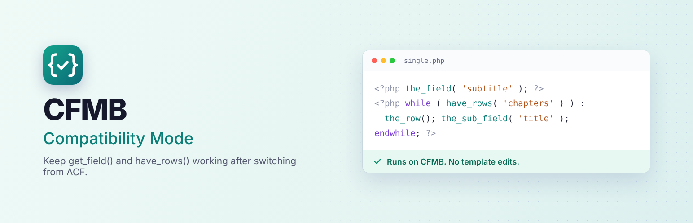

  

# CFMB Compatibility Mode

**Keep `get_field()`, `have_rows()` and other ACF template functions working after you migrate from Advanced Custom Fields to the free [CFMB - Custom Fields Meta Box](https://wordpress.org/plugins/custom-fields-meta-box/) plugin.** No template edits needed.

**[WordPress.org](https://wordpress.org/plugins/cfmb-compatibility-mode/)** · **[CFMB on GitHub](https://github.com/mozi2wp/cfmb)**

## Supported functions

`get_field()`, `the_field()`, `get_fields()`, `get_field_object()`, `update_field()`, `delete_field()`, `have_rows()`, `the_row()`, `get_sub_field()`, `the_sub_field()`, `get_row_layout()`, `get_row_index()`, `reset_rows()`, `acf_add_options_page()`, `acf_add_options_sub_page()`.

Each is a thin wrapper around its `cfmb_` version. Arguments like `'option'`, `'user_5'`, `'term_12'` and `field_…` keys are translated.

## Migrate from ACF without breaking your theme

1. Install CFMB - Custom Fields Meta Box and run its **Switch Assistant**.
2. Install CFMB Compatibility Mode.
3. Deactivate ACF or Secure Custom Fields. The theme keeps working.
4. Replace `get_field()` with `cfmb_get_field()` over time, then remove this plugin.

## Safe next to ACF

The functions are never defined while ACF, ACF Pro or Secure Custom Fields is active, and each one is wrapped in `function_exists()`.

## License

GPLv2 or later. Made by [Mozi2WP](https://mozi2wp.com). Not affiliated with Advanced Custom Fields or WP Engine.
